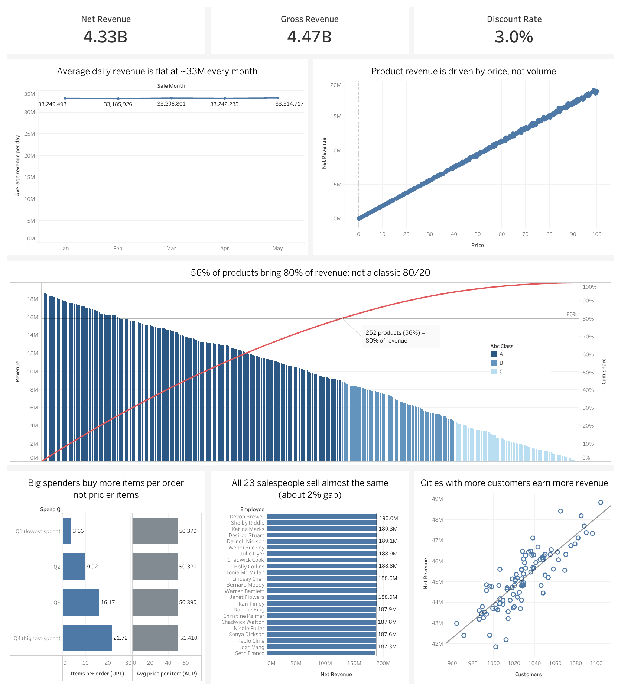

# Grocery Sales Analysis with SQL and Tableau

SQL analysis of **6.76M sales transactions** from a grocery chain (1 Jan – 9 May 2018) to evaluate performance **over time, by product, by customer, by salesperson and by city**, and turn the results into recommendations.

**Tools:** MySQL 8 (CTEs, window functions, aggregations, views, keys) · DBeaver · Tableau Public · KPI trees for problem structuring

**Interactive dashboard:** [View on Tableau Public](https://public.tableau.com/views/GrocerySalesPerformanceDashboard_17930345848490/Dashboard1)

[](https://public.tableau.com/views/GrocerySalesPerformanceDashboard_17930345848490/Dashboard1)

The dashboard shows the headline KPIs, one chart for each of the five scenarios below and a Pareto chart of products. Its data comes from the outputs of the analysis queries, exported to CSV.

---

## Key findings

**1. Revenue is flat over the period.**
Net revenue is 4.33B (after a ~3% effective discount). Monthly totals seem to drop in February and May, but only because those months have fewer days (May has 9 days of data). Revenue per day stays at ~33.2–33.3M in every month, and every KPI tree driver (orders, units per order, average unit price) is stable within each category.

**2. Product revenue is driven by price, not demand.**
All 452 products sell almost the same volume (189,906 to 199,724 units, a 1.05x range), while revenue per product differs by 2,213x. The bottom 5 products by revenue are low-price items (0.04–1.19), not slow movers. Product `Class` has little impact: each class takes about one third of revenue. An ABC analysis confirms this: 252 products (56%) bring 80% of revenue, so revenue is only moderately concentrated, not a classic 80/20. Revenue per product falls almost linearly with no long tail, and average price drops from 72.81 (class A) to 11.27 (class C).

**3. Customer spend is driven by basket size.**
Every customer buys repeatedly every month (100% monthly repeat rate, Jan–Apr), so retention is not the issue. From the lowest to the highest spend quartile, average unit price stays flat at ~50, while units per order rise from 3.66 to 21.72 and AOV from 184 to 1,116.

**4. Salespeople perform almost identically.**
All 23 salespeople sold on the same 129 days, and revenue differs by only ~2% (186.3M to 190.0M). No single driver explains the ranking, and the rank 1 and rank 23 salespeople are also the most volatile month to month, so the ranking reflects random variation.

**5. Cities differ mainly by size of customer base.**
Revenue per city ranges from 41.86M (Omaha) to 48.84M (Tucson). From the lowest to the highest revenue quartile of cities, customers per city rise from 1,000 to 1,060 and units per order from 12.87 to 13.10, while purchase frequency and average unit price stay flat.

## Recommendations

| Finding | Recommendation | Owner |
|---|---|---|
| Spend depends on basket size | Grow units per order with bundles, multi-buy offers and cross-selling, focused on low-spend customers | Marketing |
| Low revenue comes from low prices | Review pricing of the lowest-priced products (e.g. 0.04) before considering delisting; they sell as often as top sellers | Category / Pricing |
| Salesperson ranking is random | Do not use the revenue ranking alone for rewards or penalties; track orders per day and units per order, which are fair and trainable | HR / Sales |
| Cities differ by customer base | Focus on customer acquisition in weaker cities and basket-building offers in low-UPT cities (e.g. Long Beach, Omaha) | Regional managers |

## Analysis approach

Each scenario starts from a **KPI tree** that breaks net sales into MECE components. The tree is split (+) by the scenario's dimension (category, product class, customer group, salesperson, city), then (×) into drivers. Two priority leaves are chosen on each tree, and the SQL tests whether they explain the differences.

```
Net sales     = Gross sales × (1 − Effective discount rate)
Gross sales   = Customers × Frequency × AOV
AOV           = UPT (units per order) × AUR (average unit retail)
```

The KPI trees for the five scenarios are in [docs/kpi_trees](docs/kpi_trees) (written in Vietnamese).

## Business questions

| Scenario | Questions | SQL |
|---|---|---|
| 1. Revenue over time | 1.1 Total net revenue · 1.2 Monthly trend and category share · 1.3 KPI drivers by category and month | [scenario_1_revenue_over_time.sql](sql/02_analysis/scenario_1_revenue_over_time.sql) |
| 2. Products | 2.1 Top 5 / bottom 5 products · 2.2 Quantity vs revenue · 2.3 Impact of product class · 2.4 Pareto / ABC analysis | [scenario_2_products.sql](sql/02_analysis/scenario_2_products.sql) |
| 3. Customers | 3.1 Segmentation by frequency and spend · 3.2 Repeat vs one-time customers · 3.3 AOV and basket size | [scenario_3_customers.sql](sql/02_analysis/scenario_3_customers.sql) |
| 4. Salespeople | 4.1 Sales and orders per salesperson · 4.2 Top and bottom performers · 4.3 Stability over time | [scenario_4_salespeople.sql](sql/02_analysis/scenario_4_salespeople.sql) |
| 5. Geography | 5.1 Revenue by city · 5.2 Volume differences · 5.3 Indicators of regional performance | [scenario_5_geography.sql](sql/02_analysis/scenario_5_geography.sql) |

Each scenario has its own file. Every query is followed by its **Result** (numbers from the query output) and **Insight**, and each file ends with a scenario summary.

Customer and city segments use quartiles: **Q1 = lowest 25%, Q4 = highest 25%** (Q1 does not mean "bought once").

Customer segmentation is RFM-style on **Frequency** and **Monetary** only. Recency is left out because every customer buys again every month, so it would not separate customers.

## Dataset

[Grocery Sales Database](https://www.kaggle.com/datasets/andrexibiza/grocery-sales-dataset) on Kaggle: simulated grocery sales from 2018-01-01 to 2018-05-09, 7 related tables.

| Table | Rows | Description |
|---|---:|---|
| `sales` | 6,758,125 | One row per order: product, customer, salesperson, quantity, discount, date |
| `customers` | 98,759 | Customer profiles and city |
| `products` | 452 | Price, category and class |
| `categories` | 11 | Product categories |
| `employees` | 23 | Salespeople |
| `cities` | 96 | Cities and their country |
| `countries` | 206 | Countries |


## Data cleaning

Checks are in [sql/01_cleaning](sql/01_cleaning): one file per table, then one file for keys and one for the clean view. Each check is written as **query → Result → Decision**. Raw tables are never modified; all analysis runs on the view `v_sales_clean`.

| Issue | Decision |
|---|---|
| `TotalPrice` is 0 in every row | Revenue rebuilt in the view: `gross = Quantity × Price`, `net = Quantity × Price × (1 − Discount)` |
| `SalesDate` stored as text; 67,526 rows (~1%) have no date | Converted to DATETIME; missing dates kept and flagged (`has_sales_date = 0`). Used in totals, excluded only from time-based queries |
| One row = one transaction with one product | Orders = row count; basket size measured as units per order (UPT) |
| 16 duplicate groups, all with a missing date | Kept: likely coincidental, not true duplicates |
| Data Dictionary glossary lists 8 categories (Northwind sample) and types that would round prices to 0 | Category names and data types taken from the actual tables |
| Keys | No orphan IDs and no duplicate IDs, so 7 primary keys and 7 foreign keys were added |

Rows in = rows out = 6,758,125 (no rows deleted).

## Data limitations

- **Simulated data.** Volumes, shares and rates are unusually even (e.g. a 100% monthly repeat rate, identical working days for all salespeople), so the findings demonstrate the method rather than real market behaviour.
- **Short period.** About 4 months of data; May is a partial month (9 days), so months are compared per day.
- **No cost data.** Profit and margin cannot be calculated; price is used only to explain revenue differences.
- **Geography is based on customer address**, not store location. All 96 cities belong to one country, so the analysis is at city level.
- **Product `Class` is not a price tier.** Each class contains prices from ~0 to 99, and its meaning is not documented.
- **Repeat customers are defined within each month** (2+ orders in the same month).

## Repository structure

```
├── README.md
├── sql/
│   ├── 01_cleaning/                    # Run in order
│   │   ├── 01_overview.sql             # Row counts and data types, all tables
│   │   ├── 02_sales.sql                # One file per table:
│   │   ├── 03_products.sql             #   missing values, duplicates, value ranges
│   │   ├── 04_customers.sql
│   │   ├── 05_employees.sql
│   │   ├── 06_categories.sql
│   │   ├── 07_cities.sql
│   │   ├── 08_countries.sql
│   │   ├── 09_keys.sql                 # Orphan checks, primary and foreign keys
│   │   └── 10_v_sales_clean.sql        # Clean view + cleaning summary
│   └── 02_analysis/                    # One file per scenario: query → Result → Insight
│       ├── scenario_1_revenue_over_time.sql
│       ├── scenario_2_products.sql
│       ├── scenario_3_customers.sql
│       ├── scenario_4_salespeople.sql
│       └── scenario_5_geography.sql
└── docs/
    ├── dashboard.png       # Screenshot of the Tableau dashboard
    ├── schema.png
    └── kpi_trees/          # KPI tree for each scenario (Vietnamese)
```

## How to reproduce

1. Download the 7 CSV files from the Kaggle link above (`sales.csv` is ~500 MB, so it is not stored in this repo).
2. Install MySQL 8 and DBeaver.
3. Create the database `fmcg_project` and import each CSV into a table with the same name (DBeaver: right-click the database → Import Data).
4. Run the files in `sql/01_cleaning` in numerical order (the last one creates the view `v_sales_clean`), then any file in `sql/02_analysis`.
