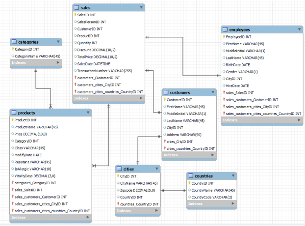

# Grocery Sales Analysis with SQL Server

SQL analysis of **6.7M+ sales transactions** from a multinational grocery chain (Jan – May 2018) to evaluate performance **over time, by product, by customer, by salesperson and by geography**, and turn it into actionable recommendations.

**Tools:** SQL Server (T-SQL: CTEs, window functions, aggregations) · DBeaver · Miro (metric trees)

<!--
TODO: Thêm công cụ vẽ biểu đồ khi đã chọn (Excel / Power BI / Python).
-->

## Key findings

<!--
TODO: Viết phần này SAU CÙNG, khi đã phân tích xong.
- Chọn 3–4 phát hiện quan trọng nhất, mỗi phát hiện là 1 câu in đậm + 1–2 câu có con số cụ thể.
- Mỗi phát hiện kèm 1 biểu đồ: 
- Tự hỏi: nếu giám đốc chỉ đọc 30 giây, họ cần biết điều gì?
-->

**1. ...**

**2. ...**

**3. ...**

## Recommendations

<!--
TODO: Mỗi đề xuất phải xuất phát từ một finding ở trên.
Tự hỏi: ai sẽ thực hiện đề xuất này (Marketing, HR, quản lý vùng)? Cần thêm dữ liệu gì để kiểm chứng?
-->

- ...

## Analysis framework

Each scenario starts from a **metric tree** that breaks the goal metric into MECE components, and the SQL analysis follows the two priority branches chosen on each tree.

Core revenue decomposition used throughout the project:

```
Net sales = Gross sales × (1 − Effective discount rate)
Gross sales = Number of transactions × AOV
Number of transactions = Number of buying customers × Purchase frequency
AOV = UPT (units per transaction) × AUR (average unit retail)
```

<!--
TODO: Nhúng ảnh metric tree đã hoàn chỉnh của từng tình huống, ví dụ:

Viết 1–2 câu: bạn khoanh 2 lá nào và vì sao.
-->

## Analysis questions

**Scenario 1 – Revenue performance over time**
1. What is the total net revenue (after discount), and how does it trend by month?
2. How does each product category's share of revenue change from month to month?

**Scenario 2 – Product ranking and classification**

3. Which are the top 5 and bottom 5 products by cumulative revenue over the period?
4. Which products have high demand (quantity) but low revenue contribution?
5. How does product `Class` affect overall sales performance?

**Scenario 3 – Customer behaviour**

6. How can customers be segmented based on two key metrics?
7. What is the split between repeat customers and one-time buyers?
8. What are the average order value (AOV) and basket size?

**Scenario 4 – Salesperson performance**

9. What are the total sales and number of transactions handled by each salesperson?
10. Who are the top performers and underperformers?
11. How stable is each salesperson's contribution over time?

**Scenario 5 – Revenue by geography**

12. What is the revenue by city and country, and which markets are strongest?
13. How does sales volume differ across regions?
14. Which metrics best show whether the current regional strategy is working?

<!--
TODO: Sau khi làm xong mỗi tình huống, thêm 1 mục chi tiết theo mẫu:

### Scenario 1 – Revenue performance over time
**Question:** ...
**SQL:** [02_scenario1_revenue.sql](sql/02_scenario1_revenue.sql)
**Result:** bảng hoặc biểu đồ
**Insight:** ...
-->

## Dataset

The [Grocery Sales Database](https://www.kaggle.com/datasets/andrexibiza/grocery-sales-dataset) contains 7 related tables:

| Table | Rows | Description |
|---|---:|---|
| `sales` | 6,758,125 | Transaction lines: product, customer, salesperson, quantity, discount, date |
| `customers` | 98,759 | Customer profiles and city |
| `products` | 452 | Product master data: price, category, class |
| `categories` | 11 | Product categories |
| `employees` | 23 | Salespeople |
| `cities` | 96 | Cities and the country they belong to |
| `countries` | 206 | Countries |



<!--
TODO: Kiểm tra lại link Kaggle ở trên có đúng là nguồn bạn tải dữ liệu không; nếu không, sửa hoặc ghi nguồn từ khoá học.
-->

## Data cleaning

Cleaning is done in T-SQL without modifying the raw tables: `raw` tables → checks and decisions → `clean` tables/views → analysis.

Issues found so far:

- **`TotalPrice` is 0 in every row**, so revenue is rebuilt as `Quantity × Price × (1 − Discount)`, with `Price` taken from `products`.
- **`Discount` is a rate**, with only three values: 0, 0.1 and 0.2.
- **The data covers 1 Jan – 9 May 2018**, so May has only 9 days; months are compared on a **per-day average** basis.
- **67,526 rows (~1%) have no `SalesDate`.**
- No negative quantities or prices, and no `ProductID` missing from `products`.

<!--
TODO: Với mỗi vấn đề, ghi QUYẾT ĐỊNH + LÝ DO (giống README Netflix). Các điểm còn mở:
- 67.526 dòng thiếu SalesDate: giữ cho tổng doanh thu nhưng loại khỏi phân tích theo tháng? Hay xoá? Vì sao?
- Trùng lặp (đã bỏ SalesID khỏi phép so sánh chưa?)
- TransactionNumber: mỗi dòng là một đơn hàng riêng? Điều này ảnh hưởng thế nào tới AOV và basket size?
- Khoá ngoại CustomerID, SalesPersonID, CityID → CountryID
- categories có 11 dòng nhưng glossary chỉ có 8 ngành hàng
- Giá thấp nhất 0,0449 so với kiểu DECIMAL(4,0) trong dictionary
Cuối mục: bảng số dòng trước / sau.
-->

## Data limitations

- The data appears to be **synthetic**: category shares stay almost flat across months, so findings should be read as a demonstration of the method rather than real market behaviour.

<!--
TODO: Bổ sung các giới hạn khác khi phân tích (ví dụ: chỉ có ~4 tháng, không có dữ liệu chi phí nên không tính được lợi nhuận, ...).
-->

## Repository structure

```
├── README.md
├── docs/            # Brief, schema, data dictionary, metric trees
├── sql/
│   ├── 00_setup.sql             # Create tables, BULK INSERT the CSVs
│   ├── 01_cleaning.sql          # Data checks and clean tables/views
│   └── 02_scenario1_revenue.sql # One file per scenario
├── images/          # Charts used in this README
└── data/raw/        # CSV files (not tracked, see below)
```

## How to reproduce

1. Download the 7 CSV files from the dataset link above into `data/raw/` (`sales.csv` is ~500 MB, so it is not stored in this repo).
2. Install SQL Server Developer Edition (free) and DBeaver or SSMS.
3. Update the file paths in `sql/00_setup.sql` to your `data/raw/` folder, then run the scripts in order: `00_setup.sql` → `01_cleaning.sql` → scenario files.
